# infa.store

Toko online reseller yang menjual brand lokal Indonesia (CHMB, Telepati, Calle, Preface) serta Crocs dan sneakers.
Proyek tugas mata kuliah Pemrograman Web: penerapan **HTML, CSS, JavaScript, dan API**.

- Nama : (ALLDISA PUTRA PINDHA PRADANA)
- NIM  : (202410370110005)
- Kelas: (PEMROGRAMAN WEB H )

## Konsep
Pengguna adalah pembeli. Toko ini adalah toko reseller, jadi produk berasal dari berbagai brand dan dikurasi dalam satu tempat.
Alur belanja: **katalog, detail produk, keranjang, pengiriman, pembayaran, struk**.
WhatsApp hanya dipakai untuk mengirim struk setelah pembayaran, bukan untuk memesan.

## Teknologi
| Bagian | Teknologi |
|---|---|
| Struktur | HTML5 (semantik, aksesibel) |
| Tampilan | CSS3 (grid, flexbox, responsif, mode gelap) |
| Interaksi | JavaScript murni (tanpa framework) |
| API | Laravel (PHP) dengan Eloquent dan database SQLite |

## Fitur
- Katalog dengan filter brand, filter kategori (kaos, hoodie, jaket, celana, topi, kupluk, tote bag, sneakers, Crocs), pencarian, dan urutan harga.
- Halaman detail produk: slide foto, deskripsi, pilihan ukuran dengan stok per ukuran, bahan dan spesifikasi, panduan ukuran.
- Keranjang yang membedakan ukuran dan membatasi jumlah sesuai stok.
- Checkout: form pengiriman dengan validasi, pilihan kurir dan ongkir (gratis di atas Rp500.000), metode pembayaran, struk.
- Tampilan responsif untuk HP dan mode gelap otomatis.
- Frontend mengambil data dari API Laravel. Jika API tidak menyala, otomatis memakai data lokal.

## Struktur folder
```
infa-store/
|-- index.html        struktur halaman
|-- style.css         seluruh gaya tampilan
|-- script.js         logika frontend (filter, detail, keranjang, checkout)
|-- images/           foto produk (.jpg)
|-- docs/             screenshot dokumentasi
|-- laravel-api/      file API Laravel (migrasi, model, controller, seeder)
```

## Cara menjalankan
### A. Frontend saja (data lokal)
1. Buka folder di VSCode.
2. Pasang ekstensi Live Server, klik kanan `index.html`, pilih Open with Live Server.

### B. Frontend + API Laravel
1. Pasang PHP 8.2+ dan Composer (di Windows paling mudah memakai Laragon).
2. `composer create-project laravel/laravel infa-api` lalu `cd infa-api`
3. `php artisan install:api`
4. Salin isi folder `laravel-api/` ke dalam proyek `infa-api` (timpa jika ditanya).
5. `php artisan migrate:fresh --seed`
6. `php artisan serve` (API aktif di http://127.0.0.1:8000)
7. Buka frontend dengan Live Server. Teks di footer akan berubah menjadi "sumber data: API Laravel".

## Dokumentasi API
Base URL: `http://127.0.0.1:8000/api`

| Method | Endpoint | Keterangan |
|---|---|---|
| GET | `/products` | Daftar produk. Query: `brand`, `category`, `q`, `sort` (`newest`, `price_asc`, `price_desc`, `name`) |
| GET | `/products/{slug}` | Detail satu produk beserta varian ukuran dan stok |
| GET | `/brands` | Daftar brand beserta jumlah produk |
| GET | `/categories` | Daftar kategori beserta jumlah produk |

Contoh: `GET /api/products?brand=calle&sort=price_asc`

```json
{
  "data": [
    {
      "id": 8,
      "name": "Tee Gang Sempit",
      "slug": "calle-tee-gang-sempit",
      "price": 229000,
      "tag": "Stok terbatas",
      "brand": { "id": 3, "name": "Calle", "slug": "calle" },
      "category": { "id": 1, "name": "Kaos", "slug": "tee" },
      "variants": [ { "id": 29, "product_id": 8, "size": "S", "stock": 7 } ]
    }
  ]
}
```
Catatan keamanan: harga modal reseller (`cost`) disembunyikan dari respons publik, dan parameter query divalidasi.

<!-- Setelah API berjalan, simpan screenshot http://127.0.0.1:8000/api/products sebagai docs/11-api-products.png lalu hapus tanda komentar:

-->

### Rancangan database (ERD)
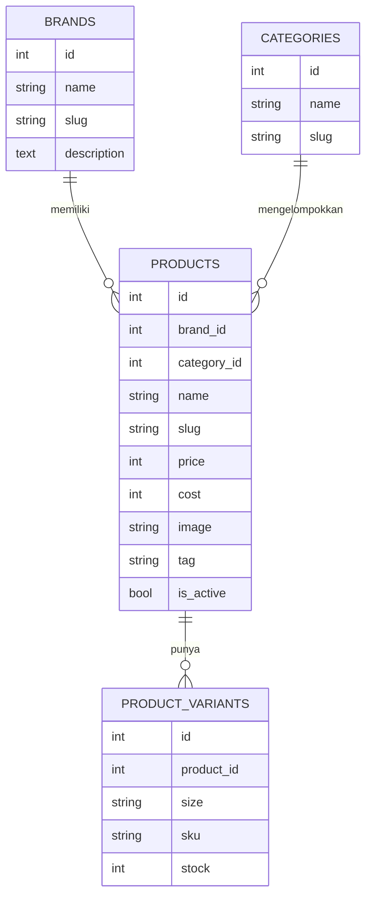

## Dokumentasi tampilan
**1. Beranda**
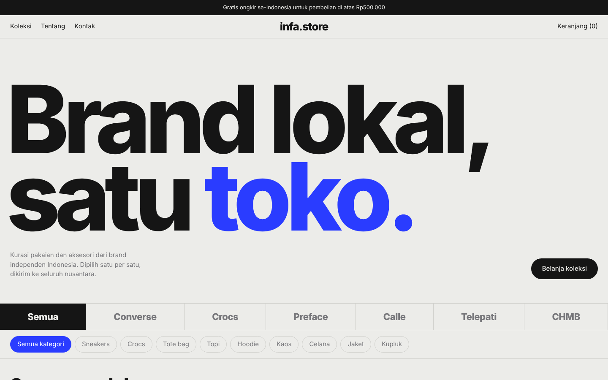

**2. Katalog dengan filter brand dan kategori**
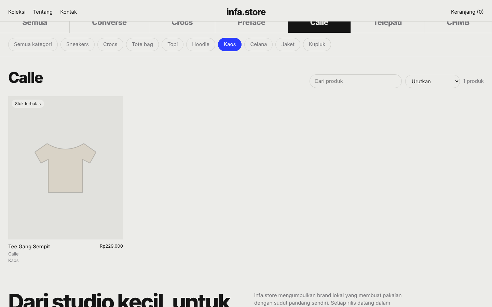

**3. Detail produk**
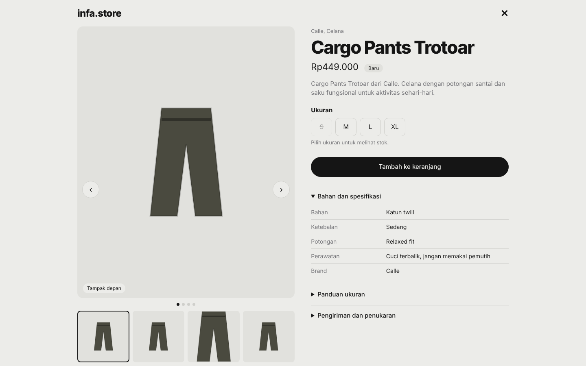

**4. Slide foto dan pilihan ukuran**
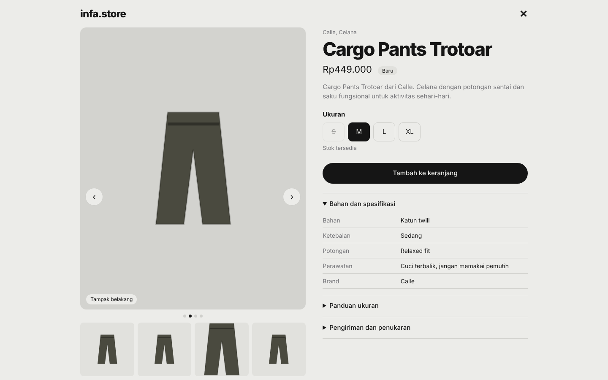

**5. Keranjang**
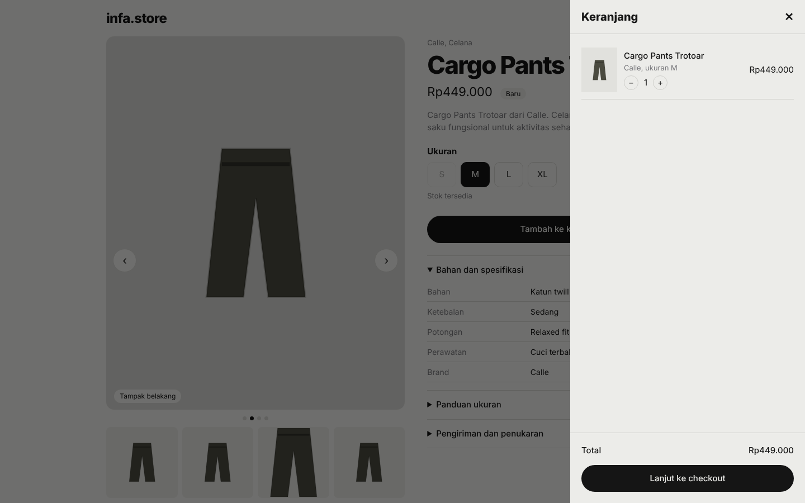

**6. Checkout: pengiriman dan pilihan kurir**
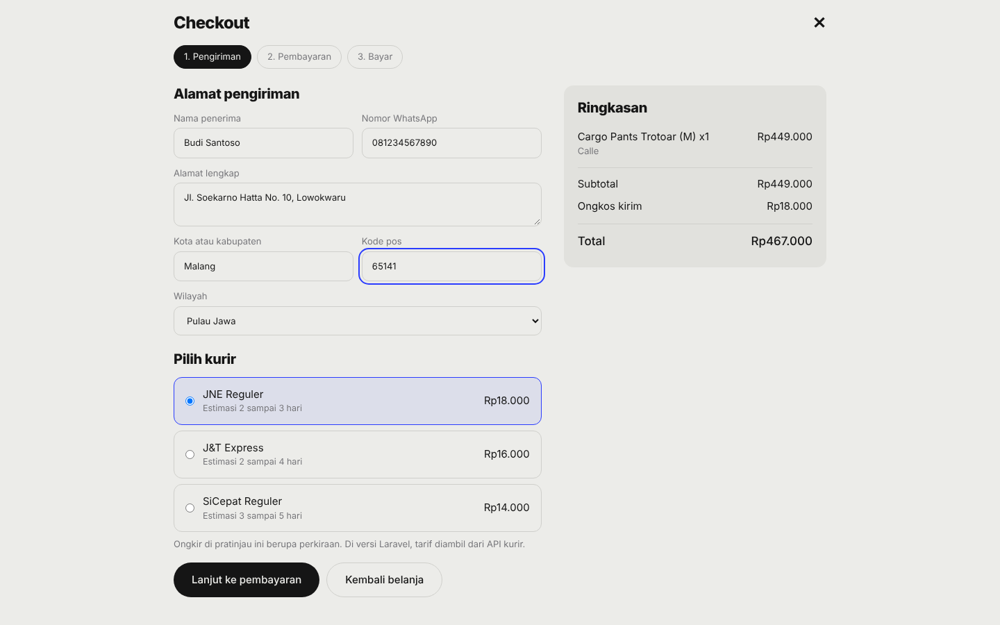

**7. Checkout: metode pembayaran**
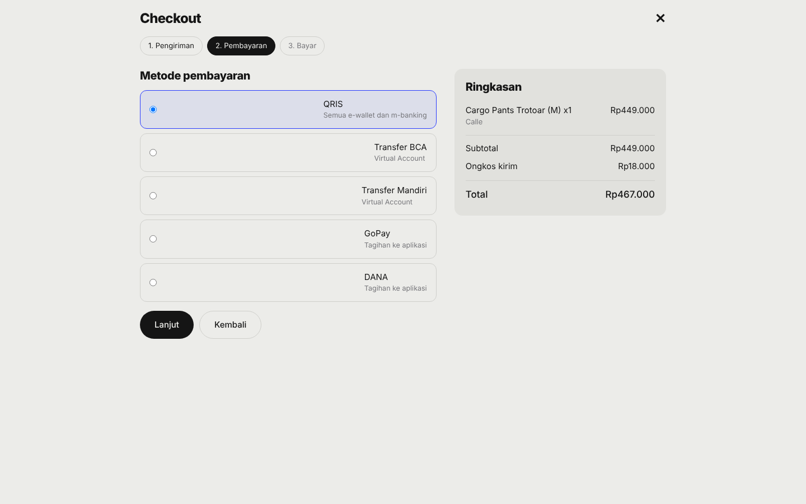

**8. Checkout: instruksi pembayaran (simulasi)**
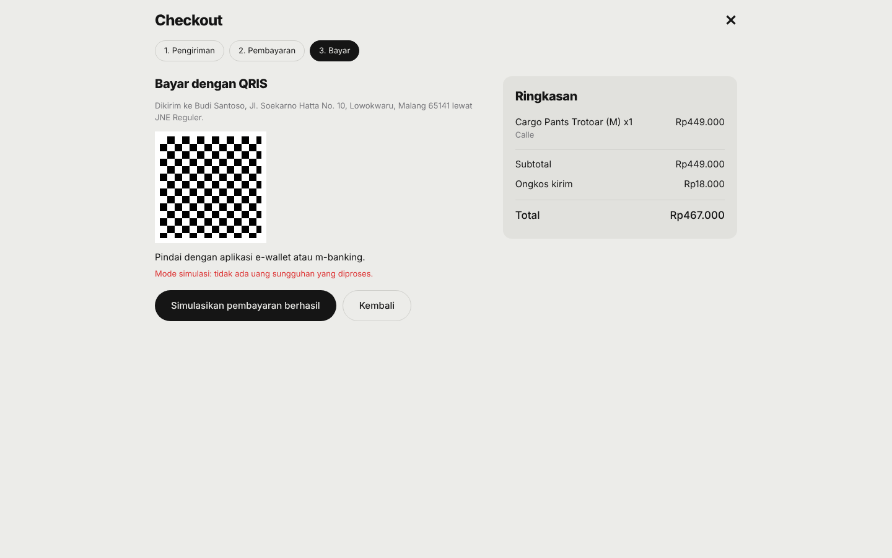

**9. Struk pembelian**
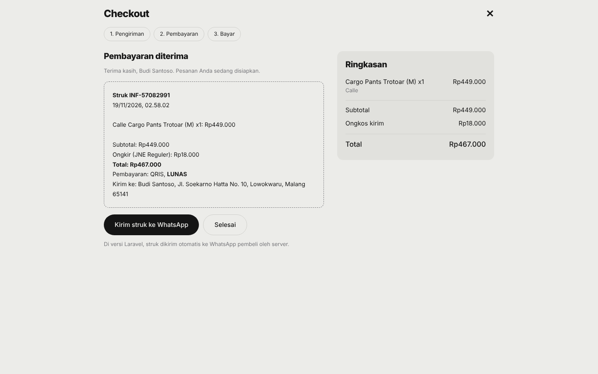

**10. Tampilan mobile**
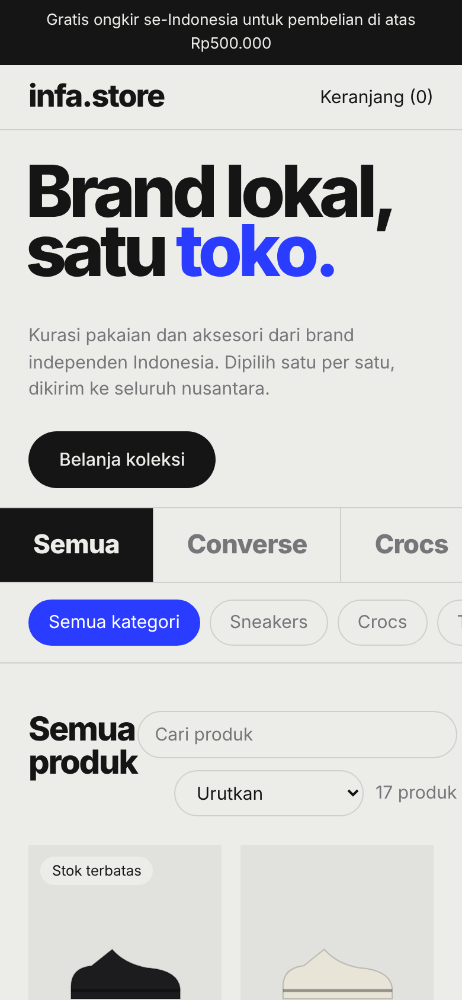

## Rencana pengembangan
1. Halaman detail produk dan halaman per brand yang dilayani langsung oleh Laravel.
2. Akun pengguna (daftar dan masuk dengan Laravel Sanctum).
3. Pesanan tersimpan di database, stok berkurang otomatis.
4. Panel admin untuk produk, stok, dan pesanan.
5. Pembayaran Midtrans (sandbox) dan ongkir Biteship atau RajaOngkir.
6. Struk dikirim otomatis ke WhatsApp pembeli.

## Catatan
- Pembayaran dan ongkir pada versi ini masih simulasi.
- Deskripsi, bahan, dan tabel ukuran adalah data contoh. Foto produk perlu diganti dengan foto resmi dari brand.
